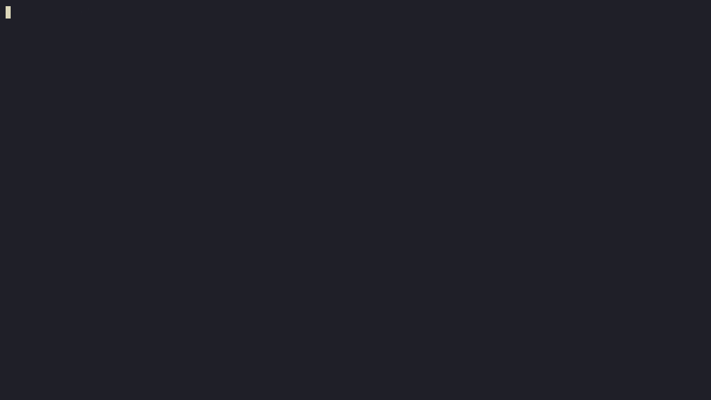
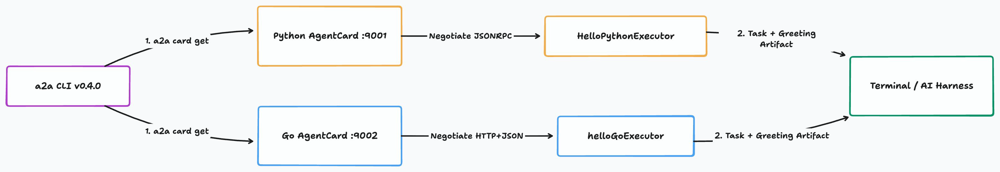
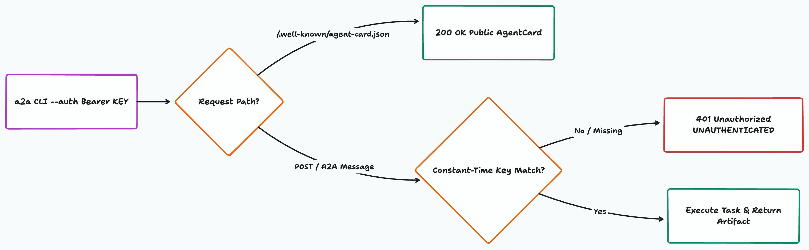

# Meet A2A CLI: A Hello World & API Key Auth Guide in Python and Go

## TL;DR

**Think of [`a2a-cli` (`a2a`)](https://github.com/a2aproject/a2a-cli) as `curl` for Agent-to-Agent (A2A) servers.** Point it at any A2A URL, and it fetches the Agent Card, picks the transport (`JSONRPC`, `HTTP+JSON`, or `gRPC`), and sends your message. You can drive it from your terminal or from any AI coding tool (Claude Code, Cursor, Codex, Antigravity). Below, pick **Python** or **Go** to stand up a minimal A2A v1.0 "Hello World" server, test it with `a2a` (`v0.4.0`), and lock it down with a Bearer API key (`a2a send --auth`).

<!-- AI Image Generation Prompt: A minimalist, clean modern tech illustration of a command-line terminal node connecting via glowing cyan and emerald protocol beams to two polyglot AI agent nodes (one warm gold-blue and one electric cyan) through a cryptographic key shield gate on a dark slate #0f172a background, professional developer infrastructure aesthetic, zero text. -->


______________________________________________________________________

## Why We Built `a2a-cli`

Every time I built a new A2A agent in Python or Go, I hit the same annoying step five minutes in: *how do I actually ping this thing?*

Before `a2a-cli`, testing a new server meant writing a 50-line `test_client.py` script just to resolve the card, wire up a transport factory, and send `"hello"`. Worse, different community tools used different flags and output shapes. Local coding agents (like Claude Code, Cursor, or Antigravity) also had no shared way to hand off tasks to a remote A2A server from bash.

So we built **[`a2a-cli` (`a2a`)](https://github.com/a2aproject/a2a-cli)** to be one universal client for any A2A server:

- **One command surface across every transport**: Whether the server speaks JSON-RPC, REST (`HTTP+JSON`), or gRPC, `a2a card get` and `a2a send` work the exact same way.
- **Ready for coding agents**: Install the [`a2a-cli` skill](https://github.com/a2aproject/a2a-cli/tree/main/skills/a2a-cli) (`npx skills add https://github.com/a2aproject/a2a-cli --skill a2a-cli`), and any tool-calling agent can discover and message remote A2A agents on its own.
- **Built-in auth and interactive chat (`v0.4.0`)**: Pass API keys or tokens with `--auth`, load them from `A2ACLI_AUTH` or `.env`, plug in a `--credential-helper`, or open a live multi-turn session with `a2a chat`.

Here is the whole workflow in action against our Python and Go servers:

<!-- AI Image Generation Prompt: Animated terminal recording showing a2a version 0.4.0 discovering and messaging Python and Go Hello World agents and verifying Bearer API keys with a2a send --auth. -->



______________________________________________________________________

## Install (or Upgrade) `a2a` to `v0.4.0`

If you don't have `a2a` yet—or if you're on `0.3.x`—grab `v0.4.0`:

=== "Homebrew (macOS / Linux)"

    ```bash
    # First-time install
    brew tap a2aproject/a2a-cli https://github.com/a2aproject/a2a-cli
    brew install a2a

    # Upgrade an existing install to v0.4.0+
    brew update && brew upgrade a2a

    a2a version
    ```

=== "Go Toolchain"

    ```bash
    go install github.com/a2aproject/a2a-cli@latest
    # go install names the binary a2a-cli; rename it to a2a
    mv "$(command -v a2a-cli)" "$(dirname "$(command -v a2a-cli)")/a2a"

    a2a version
    ```

=== "WinGet (Windows)"

    ```powershell
    winget install a2aproject.a2acli
    a2a version
    ```

______________________________________________________________________

## Step 1: Build a Minimal A2A "Hello World" Server

Let's start with the smallest complete A2A v1.0 server.

Under the hood, our Python sample uses `JSONRPC` on port `9001` (`a2a-sdk`), while our Go sample uses `HTTP+JSON` on port `9002` (`a2a-go/v2`). Notice how `a2a` doesn't care which one you pick: it reads `/.well-known/agent-card.json` first and switches transports automatically.

<!-- AI Image Generation Prompt: Clean tldraw flowchart showing a2a CLI v0.4.0 discovering Python (:9001, JSONRPC) and Go (:9002, HTTP+JSON) AgentCards and receiving Task + Greeting Artifacts. -->



Pick your language below (clicking a tab switches every code block on the page):

### The Server Code

=== "Python"

    Full source in this repo: [`samples/01-python-hello/server.py`](samples/01-python-hello/server.py) and [`samples/01-python-hello/pyproject.toml`](samples/01-python-hello/pyproject.toml).

    ```python
    """Minimal A2A v1.0 Hello World server in Python."""

    import os
    import uvicorn
    from starlette.applications import Starlette

    from a2a.helpers import (
        get_message_text,
        new_task_from_user_message,
        new_text_message,
        new_text_part,
    )
    from a2a.server.agent_execution import AgentExecutor, RequestContext
    from a2a.server.events import EventQueue
    from a2a.server.request_handlers import DefaultRequestHandler
    from a2a.server.routes import create_agent_card_routes, create_jsonrpc_routes
    from a2a.server.tasks import InMemoryTaskStore, TaskUpdater
    from a2a.types import AgentCapabilities, AgentCard, AgentInterface, AgentSkill
    from a2a.types.a2a_pb2 import TaskState

    HOST = os.environ.get("A2A_HOST", "127.0.0.1")
    PORT = int(os.environ.get("A2A_PORT", "9001"))
    BASE_URL = os.environ.get("A2A_BASE_URL", f"http://{HOST}:{PORT}")


    class HelloPythonExecutor(AgentExecutor):
        """Handles incoming A2A messages and replies with a greeting artifact."""

        async def execute(self, context: RequestContext, event_queue: EventQueue) -> None:
            task = context.current_task
            if not task:
                task = new_task_from_user_message(context.message)
                await event_queue.enqueue_event(task)

            updater = TaskUpdater(
                event_queue=event_queue, task_id=task.id, context_id=task.context_id
            )
            await updater.update_status(
                state=TaskState.TASK_STATE_WORKING,
                message=new_text_message("Processing greeting in Python..."),
            )

            user_text = get_message_text(context.message) or "World"
            reply = f'Hello from Python A2A Agent! You said: "{user_text}"'

            await updater.add_artifact(
                parts=[new_text_part(text=reply, media_type="text/plain")]
            )
            await updater.update_status(
                state=TaskState.TASK_STATE_COMPLETED,
                message=new_text_message("Greeting complete."),
            )

        async def cancel(self, context: RequestContext, event_queue: EventQueue) -> None:
            updater = TaskUpdater(
                event_queue=event_queue,
                task_id=context.task_id or "",
                context_id=context.context_id or "",
            )
            await updater.cancel()


    def build_agent_card() -> AgentCard:
        return AgentCard(
            name="Python Hello World Agent",
            description="Minimal A2A v1.0 Hello World agent built with a2a-sdk in Python.",
            version="1.0.0",
            default_input_modes=["text/plain"],
            default_output_modes=["text/plain"],
            capabilities=AgentCapabilities(streaming=True),
            supported_interfaces=[
                AgentInterface(
                    protocol_binding="JSONRPC",
                    url=BASE_URL,
                    protocol_version="1.0",
                )
            ],
            skills=[
                AgentSkill(
                    id="hello-python",
                    name="Python Greeting",
                    description="Echoes a greeting from the Python A2A server.",
                    input_modes=["text/plain"],
                    output_modes=["text/plain"],
                    tags=["hello", "python", "a2a"],
                    examples=["Hello from A2A CLI!"],
                )
            ],
        )


    def build_app() -> Starlette:
        card = build_agent_card()
        handler = DefaultRequestHandler(
            agent_executor=HelloPythonExecutor(),
            task_store=InMemoryTaskStore(),
            agent_card=card,
        )
        routes = [
            *create_agent_card_routes(card),
            *create_jsonrpc_routes(handler, rpc_url="/"),
        ]
        return Starlette(routes=routes)


    if __name__ == "__main__":
        print(f"Python Hello World A2A server listening on {BASE_URL}")
        uvicorn.run(build_app(), host=HOST, port=PORT, log_level="warning")
    ```

=== "Go"

    Full source in this repo: [`samples/02-go-hello/main.go`](samples/02-go-hello/main.go) and [`samples/02-go-hello/go.mod`](samples/02-go-hello/go.mod).

    ```go
    // Minimal A2A v1.0 Hello World server in Go.
    package main

    import (
    	"context"
    	"fmt"
    	"iter"
    	"log"
    	"net/http"
    	"os"
    	"strings"

    	"github.com/a2aproject/a2a-go/v2/a2a"
    	"github.com/a2aproject/a2a-go/v2/a2asrv"
    )

    type helloGoExecutor struct{}

    func (e *helloGoExecutor) Execute(_ context.Context, execCtx *a2asrv.ExecutorContext) iter.Seq2[a2a.Event, error] {
    	return func(yield func(a2a.Event, error) bool) {
    		if execCtx.StoredTask == nil {
    			if !yield(a2a.NewSubmittedTask(execCtx, execCtx.Message), nil) {
    				return
    			}
    		}
    		if !yield(a2a.NewStatusUpdateEvent(execCtx, a2a.TaskStateWorking, nil), nil) {
    			return
    		}

    		userText := extractText(execCtx.Message)
    		reply := fmt.Sprintf("Hello from Go A2A Agent! You said: %q", userText)

    		evt := a2a.NewArtifactEvent(execCtx, a2a.NewTextPart(reply))
    		evt.LastChunk = true
    		if !yield(evt, nil) {
    			return
    		}
    		yield(a2a.NewStatusUpdateEvent(execCtx, a2a.TaskStateCompleted, nil), nil)
    	}
    }

    func (e *helloGoExecutor) Cancel(_ context.Context, execCtx *a2asrv.ExecutorContext) iter.Seq2[a2a.Event, error] {
    	return func(yield func(a2a.Event, error) bool) {
    		yield(a2a.NewStatusUpdateEvent(execCtx, a2a.TaskStateCanceled, nil), nil)
    	}
    }

    func extractText(msg *a2a.Message) string {
    	if msg == nil {
    		return "World"
    	}
    	var parts []string
    	for _, p := range msg.Parts {
    		if t := p.Text(); t != "" {
    			parts = append(parts, t)
    		}
    	}
    	if len(parts) == 0 {
    		return "World"
    	}
    	return strings.Join(parts, " ")
    }

    func envOr(key, fallback string) string {
    	if v := os.Getenv(key); v != "" {
    		return v
    	}
    	return fallback
    }

    func main() {
    	host := envOr("A2A_HOST", "127.0.0.1")
    	port := envOr("A2A_PORT", "9002")
    	addr := fmt.Sprintf("%s:%s", host, port)
    	baseURL := envOr("A2A_BASE_URL", "http://"+addr)

    	card := &a2a.AgentCard{
    		Name:               "Go Hello World Agent",
    		Description:        "Minimal A2A v1.0 Hello World agent built with a2a-go/v2.",
    		Version:            "1.0.0",
    		Capabilities:       a2a.AgentCapabilities{Streaming: true},
    		DefaultInputModes:  []string{"text/plain"},
    		DefaultOutputModes: []string{"text/plain"},
    		SupportedInterfaces: []*a2a.AgentInterface{
    			a2a.NewAgentInterface(baseURL, a2a.TransportProtocolHTTPJSON),
    		},
    		Skills: []a2a.AgentSkill{
    			{
    				ID:          "hello-go",
    				Name:        "Go Greeting",
    				Description: "Echoes a greeting from the Go A2A server.",
    				Tags:        []string{"hello", "go", "a2a"},
    				Examples:    []string{"Hello from A2A CLI!"},
    			},
    		},
    	}

    	handler := a2asrv.NewHandler(&helloGoExecutor{})
    	mux := http.NewServeMux()
    	mux.Handle(a2asrv.WellKnownAgentCardPath, a2asrv.NewStaticAgentCardHandler(card))
    	mux.Handle("/", a2asrv.NewRESTHandler(handler))

    	log.Printf("Go Hello World A2A server listening on %s", baseURL)
    	if err := http.ListenAndServe(addr, mux); err != nil {
    		log.Fatal(err)
    	}
    }
    ```

### Run & Test with `a2a`

=== "Python"

    Start the server in one terminal:

    ```bash
    cd docs/writing/a2a/a2a-cli-hello-world/samples/01-python-hello
    uv run python server.py
    ```

    In a second terminal, inspect the card and send a message:

    ```bash
    # 1. Fetch the Agent Card
    a2a card get http://127.0.0.1:9001

    # 2. Send a message
    a2a send -a http://127.0.0.1:9001 "Hello Python from a2a-cli!"
    ```

    ```text
    Name:         Python Hello World Agent
    Description:  Minimal A2A v1.0 Hello World agent built with a2a-sdk in Python.
    Version:      1.0.0
    Interfaces:
      JSONRPC (A2A v1.0)     http://127.0.0.1:9001
    Streaming:    true
    Skills:
      hello-python         Python Greeting

    Task:     0c84d885-f1ce-49b8-bb87-3465f88e9e3f
    Context:  2966a12d-abe0-415d-9ad5-31181cfc564a
    Status:   completed
      Greeting complete.
    Artifacts:
      [6ba5e903-2435-4093-8717-7351a96c4b6a] Hello from Python A2A Agent! You said: "Hello Python from a2a-cli!"
    ```

=== "Go"

    Start the server in one terminal:

    ```bash
    cd docs/writing/a2a/a2a-cli-hello-world/samples/02-go-hello
    go run .
    ```

    In a second terminal, inspect the card and send a message:

    ```bash
    # 1. Fetch the Agent Card
    a2a card get http://127.0.0.1:9002

    # 2. Send a message
    a2a send -a http://127.0.0.1:9002 "Hello Go from a2a-cli!"
    ```

    ```text
    Name:         Go Hello World Agent
    Description:  Minimal A2A v1.0 Hello World agent built with a2a-go/v2.
    Version:      1.0.0
    Interfaces:
      HTTP+JSON (A2A v1.0)   http://127.0.0.1:9002
    Streaming:    true
    Skills:
      hello-go             Go Greeting

    Task:     01a1c59a-4bb3-7d9c-b196-2c65286800b5
    Context:  01a1c59a-4bb3-7e6f-b081-c4a795fdf656
    Status:   completed
    Artifacts:
      [01a1c59a-4bb3-7ed4-b6b6-964fbcd6c65c] Hello from Go A2A Agent! You said: "Hello Go from a2a-cli!"
    ```

______________________________________________________________________

## Step 2: Add Bearer API Key Verification (`--auth`)

A localhost echo server is fine for a five-minute test, but the moment you expose an agent over a network, you need caller authentication.

The cleanest pattern in A2A has two parts:

1. **Leave `GET /.well-known/agent-card.json` public** so `a2a card get` (and agent registries) can still discover the agent and see its `securitySchemes`.
1. **Guard the task/message endpoint (`POST /`)** with a constant-time token check (`hmac.compare_digest` in Python, `subtle.ConstantTimeCompare` in Go) so an attacker cannot guess your key byte-by-byte using response timing.

<!-- AI Image Generation Prompt: Clean tldraw flowchart showing a2a CLI passing --auth Bearer KEY, allowing /.well-known/agent-card.json publicly while enforcing constant-time API key verification on POST / A2A message calls. -->



> [!TIP]
> **One real gotcha with `HTTP+JSON` error bodies:** When a REST (`HTTP+JSON`) A2A server returns `401 Unauthorized`, the Go SDK client parses the body as a `google.rpc.Status` JSON object (`{"error": {"code": 401, "status": "UNAUTHENTICATED", "message": "..."}}`). If you return a flat string like `{"error": "unauthorized"}`, the client fails with a JSON unmarshal error instead of printing your auth message. Both samples below use the structured error body so `a2a` prints a clean one-line error.

### The Secured Server Code

=== "Python"

    Full source in this repo: [`samples/03-python-auth/server.py`](samples/03-python-auth/server.py) and [`samples/03-python-auth/pyproject.toml`](samples/03-python-auth/pyproject.toml).

    ```python
    """A2A v1.0 Hello World server in Python with API key Bearer token verification."""

    import hmac
    import os
    import uvicorn
    from starlette.applications import Starlette
    from starlette.middleware import Middleware
    from starlette.middleware.base import BaseHTTPMiddleware
    from starlette.requests import Request
    from starlette.responses import JSONResponse

    from a2a.helpers import (
        get_message_text,
        new_task_from_user_message,
        new_text_message,
        new_text_part,
    )
    from a2a.server.agent_execution import AgentExecutor, RequestContext
    from a2a.server.events import EventQueue
    from a2a.server.request_handlers import DefaultRequestHandler
    from a2a.server.routes import create_agent_card_routes, create_jsonrpc_routes
    from a2a.server.tasks import InMemoryTaskStore, TaskUpdater
    from a2a.types import (
        AgentCapabilities,
        AgentCard,
        AgentInterface,
        AgentSkill,
        HTTPAuthSecurityScheme,
        SecurityScheme,
    )
    from a2a.types.a2a_pb2 import TaskState
    from a2a.utils.constants import AGENT_CARD_WELL_KNOWN_PATH

    HOST = os.environ.get("A2A_HOST", "127.0.0.1")
    PORT = int(os.environ.get("A2A_PORT", "9003"))
    BASE_URL = os.environ.get("A2A_BASE_URL", f"http://{HOST}:{PORT}")
    EXPECTED_API_KEY = os.environ.get("A2A_API_KEY", "a2a-demo-secret-key")


    class ApiKeyAuthMiddleware(BaseHTTPMiddleware):
        """Allows public Agent Card discovery and requires a valid Bearer API key on RPC calls."""

        async def dispatch(self, request: Request, call_next):
            if request.url.path == AGENT_CARD_WELL_KNOWN_PATH:
                return await call_next(request)

            auth_header = request.headers.get("authorization", "")
            scheme, _, token = auth_header.partition(" ")
            if scheme.lower() != "bearer" or not hmac.compare_digest(
                token.strip(), EXPECTED_API_KEY
            ):
                return JSONResponse(
                    {
                        "error": {
                            "code": 401,
                            "status": "UNAUTHENTICATED",
                            "message": "Missing or invalid Bearer API key token.",
                        }
                    },
                    status_code=401,
                    headers={"WWW-Authenticate": "Bearer"},
                )
            return await call_next(request)


    class SecuredPythonExecutor(AgentExecutor):
        """Replies after the middleware has verified the caller's API key."""

        async def execute(self, context: RequestContext, event_queue: EventQueue) -> None:
            task = context.current_task
            if not task:
                task = new_task_from_user_message(context.message)
                await event_queue.enqueue_event(task)

            updater = TaskUpdater(
                event_queue=event_queue, task_id=task.id, context_id=task.context_id
            )
            await updater.update_status(
                state=TaskState.TASK_STATE_WORKING,
                message=new_text_message("Verified API key; processing in Python..."),
            )

            user_text = get_message_text(context.message) or "World"
            reply = (
                f"Hello from Secured Python A2A Agent! "
                f'API key verified. You said: "{user_text}"'
            )

            await updater.add_artifact(
                parts=[new_text_part(text=reply, media_type="text/plain")]
            )
            await updater.update_status(
                state=TaskState.TASK_STATE_COMPLETED,
                message=new_text_message("Secured greeting complete."),
            )

        async def cancel(self, context: RequestContext, event_queue: EventQueue) -> None:
            updater = TaskUpdater(
                event_queue=event_queue,
                task_id=context.task_id or "",
                context_id=context.context_id or "",
            )
            await updater.cancel()


    def build_agent_card() -> AgentCard:
        card = AgentCard(
            name="Secured Python Hello World Agent",
            description="Python A2A v1.0 agent protected by Bearer API key verification.",
            version="1.0.0",
            default_input_modes=["text/plain"],
            default_output_modes=["text/plain"],
            capabilities=AgentCapabilities(streaming=True),
            supported_interfaces=[
                AgentInterface(
                    protocol_binding="JSONRPC",
                    url=BASE_URL,
                    protocol_version="1.0",
                )
            ],
            skills=[
                AgentSkill(
                    id="hello-python-auth",
                    name="Authenticated Python Greeting",
                    description="Replies with a greeting when a valid Bearer API key is supplied.",
                    input_modes=["text/plain"],
                    output_modes=["text/plain"],
                    tags=["hello", "python", "auth", "a2a"],
                    examples=["Hello with an API key!"],
                )
            ],
        )
        card.security_schemes["bearer_api_key"].CopyFrom(
            SecurityScheme(
                http_auth_security_scheme=HTTPAuthSecurityScheme(
                    scheme="Bearer",
                    bearer_format="APIKey",
                    description="Pass the API key via `a2a send --auth 'Bearer <API_KEY>'`",
                )
            )
        )
        return card


    def build_app() -> Starlette:
        card = build_agent_card()
        handler = DefaultRequestHandler(
            agent_executor=SecuredPythonExecutor(),
            task_store=InMemoryTaskStore(),
            agent_card=card,
        )
        routes = [
            *create_agent_card_routes(card),
            *create_jsonrpc_routes(handler, rpc_url="/"),
        ]
        return Starlette(
            routes=routes,
            middleware=[Middleware(ApiKeyAuthMiddleware)],
        )


    if __name__ == "__main__":
        print(f"Secured Python A2A server listening on {BASE_URL}")
        uvicorn.run(build_app(), host=HOST, port=PORT, log_level="warning")
    ```

=== "Go"

    Full source in this repo: [`samples/04-go-auth/main.go`](samples/04-go-auth/main.go) and [`samples/04-go-auth/go.mod`](samples/04-go-auth/go.mod).

    ```go
    // A2A v1.0 Hello World server in Go with API key Bearer token verification.
    package main

    import (
    	"context"
    	"crypto/subtle"
    	"fmt"
    	"iter"
    	"log"
    	"net/http"
    	"os"
    	"strings"

    	"github.com/a2aproject/a2a-go/v2/a2a"
    	"github.com/a2aproject/a2a-go/v2/a2asrv"
    )

    type securedGoExecutor struct{}

    func (e *securedGoExecutor) Execute(_ context.Context, execCtx *a2asrv.ExecutorContext) iter.Seq2[a2a.Event, error] {
    	return func(yield func(a2a.Event, error) bool) {
    		if execCtx.StoredTask == nil {
    			if !yield(a2a.NewSubmittedTask(execCtx, execCtx.Message), nil) {
    				return
    			}
    		}
    		if !yield(a2a.NewStatusUpdateEvent(execCtx, a2a.TaskStateWorking, nil), nil) {
    			return
    		}

    		userText := extractText(execCtx.Message)
    		reply := fmt.Sprintf("Hello from Secured Go A2A Agent! API key verified. You said: %q", userText)

    		evt := a2a.NewArtifactEvent(execCtx, a2a.NewTextPart(reply))
    		evt.LastChunk = true
    		if !yield(evt, nil) {
    			return
    		}
    		yield(a2a.NewStatusUpdateEvent(execCtx, a2a.TaskStateCompleted, nil), nil)
    	}
    }

    func (e *securedGoExecutor) Cancel(_ context.Context, execCtx *a2asrv.ExecutorContext) iter.Seq2[a2a.Event, error] {
    	return func(yield func(a2a.Event, error) bool) {
    		yield(a2a.NewStatusUpdateEvent(execCtx, a2a.TaskStateCanceled, nil), nil)
    	}
    }

    func extractText(msg *a2a.Message) string {
    	if msg == nil {
    		return "World"
    	}
    	var parts []string
    	for _, p := range msg.Parts {
    		if t := p.Text(); t != "" {
    			parts = append(parts, t)
    		}
    	}
    	if len(parts) == 0 {
    		return "World"
    	}
    	return strings.Join(parts, " ")
    }

    func requireAPIKey(expectedKey string, next http.Handler) http.Handler {
    	return http.HandlerFunc(func(w http.ResponseWriter, r *http.Request) {
    		const prefix = "Bearer "
    		auth := r.Header.Get("Authorization")
    		token := ""
    		if len(auth) > len(prefix) && strings.EqualFold(auth[:len(prefix)], prefix) {
    			token = strings.TrimSpace(auth[len(prefix):])
    		}
    		if subtle.ConstantTimeCompare([]byte(token), []byte(expectedKey)) != 1 {
    			w.Header().Set("WWW-Authenticate", "Bearer")
    			w.Header().Set("Content-Type", "application/json")
    			w.WriteHeader(http.StatusUnauthorized)
    			_, _ = w.Write([]byte(`{"error":{"code":401,"status":"UNAUTHENTICATED","message":"Missing or invalid Bearer API key token."}}`))
    			return
    		}
    		next.ServeHTTP(w, r)
    	})
    }

    func envOr(key, fallback string) string {
    	if v := os.Getenv(key); v != "" {
    		return v
    	}
    	return fallback
    }

    func main() {
    	host := envOr("A2A_HOST", "127.0.0.1")
    	port := envOr("A2A_PORT", "9004")
    	addr := fmt.Sprintf("%s:%s", host, port)
    	baseURL := envOr("A2A_BASE_URL", "http://"+addr)
    	expectedKey := envOr("A2A_API_KEY", "a2a-demo-secret-key")

    	card := &a2a.AgentCard{
    		Name:               "Secured Go Hello World Agent",
    		Description:        "Go A2A v1.0 agent protected by Bearer API key verification.",
    		Version:            "1.0.0",
    		Capabilities:       a2a.AgentCapabilities{Streaming: true},
    		DefaultInputModes:  []string{"text/plain"},
    		DefaultOutputModes: []string{"text/plain"},
    		SupportedInterfaces: []*a2a.AgentInterface{
    			a2a.NewAgentInterface(baseURL, a2a.TransportProtocolHTTPJSON),
    		},
    		SecuritySchemes: a2a.NamedSecuritySchemes{
    			"bearer_api_key": a2a.HTTPAuthSecurityScheme{
    				Scheme:       "Bearer",
    				BearerFormat: "APIKey",
    				Description:  "Pass the API key via `a2a send --auth 'Bearer <API_KEY>'`",
    			},
    		},
    		Skills: []a2a.AgentSkill{
    			{
    				ID:          "hello-go-auth",
    				Name:        "Authenticated Go Greeting",
    				Description: "Replies with a greeting when a valid Bearer API key is supplied.",
    				Tags:        []string{"hello", "go", "auth", "a2a"},
    				Examples:    []string{"Hello with an API key!"},
    			},
    		},
    	}

    	handler := a2asrv.NewHandler(&securedGoExecutor{})
    	mux := http.NewServeMux()
    	mux.Handle(a2asrv.WellKnownAgentCardPath, a2asrv.NewStaticAgentCardHandler(card))
    	mux.Handle("/", requireAPIKey(expectedKey, a2asrv.NewRESTHandler(handler)))

    	log.Printf("Secured Go A2A server listening on %s", baseURL)
    	if err := http.ListenAndServe(addr, mux); err != nil {
    		log.Fatal(err)
    	}
    }
    ```

### Test Unauthenticated vs. Authenticated Calls

=== "Python"

    Start the secured Python server (`:9003`):

    ```bash
    cd docs/writing/a2a/a2a-cli-hello-world/samples/03-python-auth
    uv run python server.py
    ```

    Now test without a key, then with `--auth`:

    ```bash
    # 1. Card discovery stays public
    a2a card get http://127.0.0.1:9003

    # 2. Without --auth -> 401 Unauthorized
    a2a send -a http://127.0.0.1:9003 "Unauthorized attempt"
    # Error: failed to send message: unexpected HTTP status: 401 Unauthorized

    # 3. With --auth -> 200 OK
    a2a send -a http://127.0.0.1:9003 \
      --auth "Bearer a2a-demo-secret-key" \
      "Verified Python call!"
    ```

    ```text
    Task:     a5a5cb4e-a312-4311-8fb1-9fc3a4bf9fd0
    Context:  a7f926b4-d2b6-4dc6-ad31-bd4646ff2cd9
    Status:   completed
      Secured greeting complete.
    Artifacts:
      [bba94dfd-9215-48b8-b1d0-c78c785e6686] Hello from Secured Python A2A Agent! API key verified. You said: "Verified Python call!"
    ```

=== "Go"

    Start the secured Go server (`:9004`):

    ```bash
    cd docs/writing/a2a/a2a-cli-hello-world/samples/04-go-auth
    go run .
    ```

    Now test without a key, then with `--auth`:

    ```bash
    # 1. Card discovery stays public
    a2a card get http://127.0.0.1:9004

    # 2. Without --auth -> 401 Unauthorized
    a2a send -a http://127.0.0.1:9004 "Unauthorized attempt"
    # Error: failed to send message: Missing or invalid Bearer API key token.

    # 3. With --auth -> 200 OK
    a2a send -a http://127.0.0.1:9004 \
      --auth "Bearer a2a-demo-secret-key" \
      "Verified Go call!"
    ```

    ```text
    Task:     01a1c59a-de42-77db-b205-74df8b1f3595
    Context:  01a1c59a-de42-78dd-bbf9-968a19e26b78
    Status:   completed
    Artifacts:
      [01a1c59a-de42-7937-90df-1ed5c3f0d038] Hello from Secured Go A2A Agent! API key verified. You said: "Verified Go call!"
    ```

### Bonus: Keep Keys Out of Your Shell History

Typing `--auth "Bearer ..."` on the command line is great for a quick test, but you don't want secrets sitting in `~/.zsh_history`. In `a2a`, you have three cleaner options:

1. **Environment variable (`A2ACLI_AUTH`) or `.env` file**:
   ```bash
   export A2ACLI_AUTH="Bearer a2a-demo-secret-key"
   a2a send -a http://127.0.0.1:9004 "Using env var"
   a2a config show  # shows where auth resolved from (with the secret redacted)
   ```
1. **Custom header (`--svc-param`)** if your gateway expects `X-API-Key` instead of `Authorization`:
   ```bash
   a2a send -a http://127.0.0.1:9004 --svc-param "X-API-Key=a2a-demo-secret-key" "Custom header"
   ```
1. **Credential Helper (`--credential-helper` in `v0.4.0`)**: Point `config.yaml` at a script that mints short-lived tokens per host, and check the resolved headers with `a2a auth get <url>`.

______________________________________________________________________

## All 4 Runnable Samples in One Place

Every file from this post lives right inside [`docs/writing/a2a/a2a-cli-hello-world/samples/`](samples/01-python-hello/server.py):

| Sample | Language | Files | Default Port | Transport |
| :--- | :--- | :--- | :--- | :--- |
| **1. Hello World** | Python | [`server.py`](samples/01-python-hello/server.py) · [`pyproject.toml`](samples/01-python-hello/pyproject.toml) | `9001` | `JSONRPC` |
| **2. Hello World** | Go | [`main.go`](samples/02-go-hello/main.go) · [`go.mod`](samples/02-go-hello/go.mod) | `9002` | `HTTP+JSON` |
| **3. API Key Auth** | Python | [`server.py`](samples/03-python-auth/server.py) · [`pyproject.toml`](samples/03-python-auth/pyproject.toml) | `9003` | `JSONRPC` |
| **4. API Key Auth** | Go | [`main.go`](samples/04-go-auth/main.go) · [`go.mod`](samples/04-go-auth/go.mod) | `9004` | `HTTP+JSON` |

______________________________________________________________________

## Key Takeaway

> **Stop writing throwaway client scripts to test your agents.** If your agent speaks A2A, `a2a` is the only client you need to inspect its card, send it work across `JSONRPC`, `HTTP+JSON`, or `gRPC`, verify auth headers, and connect it to any coding tool on your machine.

- **One CLI, every language and transport**: Your Python (`a2a-sdk`) and Go (`a2a-go/v2`) servers use the exact same `a2a card get` and `a2a send` commands.
- **Discovery stays open; execution stays locked**: Keep `/.well-known/agent-card.json` public so clients know how to talk to you, and verify Bearer tokens in constant time on your task routes.
- **Any coding agent can drive `a2a`**: Add the `a2a-cli` skill once, and your local AI coding assistant can delegate tasks to any remote A2A agent.

### Where to Go Next

- **Star & try A2A CLI**: [github.com/a2aproject/a2a-cli](https://github.com/a2aproject/a2a-cli)
- **Read the A2A v1.0 Spec**: [a2a-protocol.org/latest/](https://a2a-protocol.org/latest/)
- **New to A2A?**: Start with [Docker for Agents: A Backend Engineer's Introduction to A2A](../intro/index.md)
- **Scaling to many agents?**: Read [Three Agents Behind One Door: Multi-Tenancy in A2A](../multi-tenancy/index.md)
