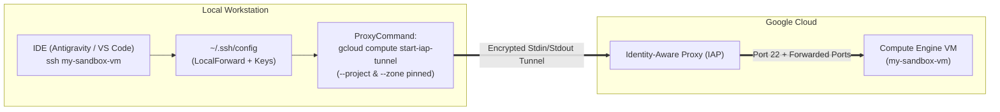

# Resilient SSH Config for Google Cloud VMs: Connecting IDE Agents via IAP Tunnel

## TL;DR

**A resilient `~/.ssh/config` block using `gcloud compute start-iap-tunnel` as a `ProxyCommand` is the cleanest way to connect local IDEs (Antigravity, VS Code, Cursor) to a Google Compute Engine (GCE) VM.** Unlike `gcloud compute config-ssh`, this approach survives ephemeral IP changes when VMs stop and start, keeps your port forwards declarative, and explicitly pins `--project` and `--zone` so switching your active `gcloud` CLI defaults never breaks your connection.

<!-- AI Image Generation Prompt: A minimalist, clean modern tech illustration of a secure encrypted network tunnel connecting a local developer workstation to a cloud server node, glowing cyan and electric blue accents on a dark slate background, no text. -->


______________________________________________________________________

## The Problem with Wrapper Scripts and `config-ssh`

Many developers start connecting to a Google Cloud sandbox VM using a shell script around [`gcloud compute ssh`](https://cloud.google.com/sdk/gcloud/reference/compute/ssh):

```bash
#!/bin/bash
gcloud compute ssh --zone "europe-west3-b" "my-sandbox-vm" \
  --project "my-sandbox-project" \
  --ssh-flag="-L 8000:localhost:8000" \
  --ssh-flag="-L 8090:localhost:8090"
```

While convenient in a terminal, wrapper scripts create three friction points when working with AI-native IDEs like **Antigravity**, **VS Code Remote-SSH**, or **Cursor**:

1. **IDEs Require Standard SSH Hosts**: Remote IDE extensions read `~/.ssh/config` host aliases directly—they cannot execute custom bash wrapper scripts.
1. **`gcloud compute config-ssh` Hardcodes Ephemeral IPs**: Running [`gcloud compute config-ssh`](https://cloud.google.com/sdk/gcloud/reference/compute/config-ssh) populates `~/.ssh/config` with static `HostName` IP addresses. Every time you stop and restart your VM, the external IP changes and breaks your config until you re-run the command.
1. **Default Context Drift**: If you switch your active `gcloud config set project` or `compute/zone` for another task, commands that rely on ambient CLI defaults suddenly fail to find your VM.

______________________________________________________________________

## How the IAP `ProxyCommand` Pattern Works

<!-- TODO: Generate image with prompt: Flowchart showing Local IDE reading ~/.ssh/config and spawning an IAP Tunnel ProxyCommand with explicit project and zone flags to reach a Compute Engine VM. -->



Instead of connecting to an IP address directly, OpenSSH invokes [`gcloud compute start-iap-tunnel`](https://cloud.google.com/sdk/gcloud/reference/compute/start-iap-tunnel) under the hood and pipes the SSH protocol over standard input/output (`--listen-on-stdin`).

______________________________________________________________________

## Step-by-Step Configuration

### 1. Ensure Your GCE SSH Key Exists

If you have logged into any Compute Engine VM using `gcloud compute ssh` at least once, Google Cloud CLI has already generated your key pair at `~/.ssh/google_compute_engine`.

If not, generate and propagate it once by running a dry run or initial login:

```bash
gcloud compute ssh my-sandbox-vm \
  --project="my-sandbox-project" \
  --zone="europe-west3-b" \
  --dry-run
```

### 2. Add the Resilient Host Entry to `~/.ssh/config`

Open `~/.ssh/config` and add a dedicated `Host` block with explicit `--project` and `--zone` flags in the `ProxyCommand`:

```sshconfig
Host my-sandbox-vm
    IdentityFile ~/.ssh/google_compute_engine
    UserKnownHostsFile ~/.ssh/google_compute_known_hosts
    IdentitiesOnly yes
    CheckHostIP no
    HostKeyAlias compute.my-sandbox-vm
    StrictHostKeyChecking accept-new
    ProxyCommand gcloud compute start-iap-tunnel my-sandbox-vm %p --listen-on-stdin --project=my-sandbox-project --zone=europe-west3-b --verbosity=warning
    LocalForward 4000 localhost:4000
    LocalForward 8000 localhost:8000
    LocalForward 8090 localhost:8090
```

### Why Each Directive Matters

| Directive | Purpose |
| :--- | :--- |
| `IdentityFile ~/.ssh/google_compute_engine` | Uses the SSH key managed and propagated by Google Cloud OS Login / metadata. |
| `ProxyCommand ... start-iap-tunnel` | Dynamically resolves the VM via [Identity-Aware Proxy (IAP)](https://cloud.google.com/iap/docs/using-tcp-forwarding) without needing a static IP or even an external IP address. |
| `--project=... --zone=...` | Hard-pins the target project and zone for this specific host so changing your global `gcloud` config never affects it. |
| `StrictHostKeyChecking accept-new` | Automatically accepts the VM host key on first connection so headless IDE background connections don't hang waiting for a `yes/no` prompt. |
| `LocalForward <local> localhost:<remote>` | Automatically forwards your development ports (e.g., web servers, Jupyter, agent dashboards) whenever the SSH session connects. |

______________________________________________________________________

## Connecting from Antigravity or VS Code

Once saved in `~/.ssh/config`:

1. **Via IDE Remote Explorer**: Open **Antigravity** (or VS Code), open the Remote-SSH connection menu, and select **`my-sandbox-vm`**.
1. **Via Terminal**: Simply run:
   ```bash
   ssh my-sandbox-vm
   ```

As long as the VM instance is running, your IDE and terminal will connect with all port forwards active—regardless of IP changes or which Google Cloud project your CLI is currently targeting.

> [!TIP]
> **Provisioning a New Sandbox VM?** Check out the companion guide on [Building an Agentic Sandbox: Provisioning a Google Cloud VM Workstation](../building-agentic-sandbox-vm/index.md) for setting up service accounts, IAM roles, and Vertex AI scopes.
